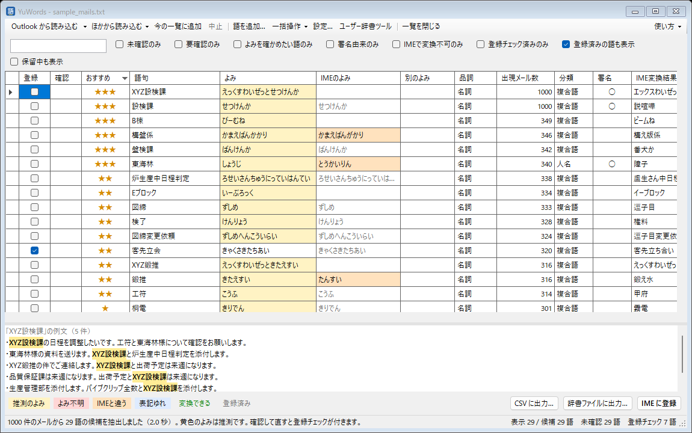
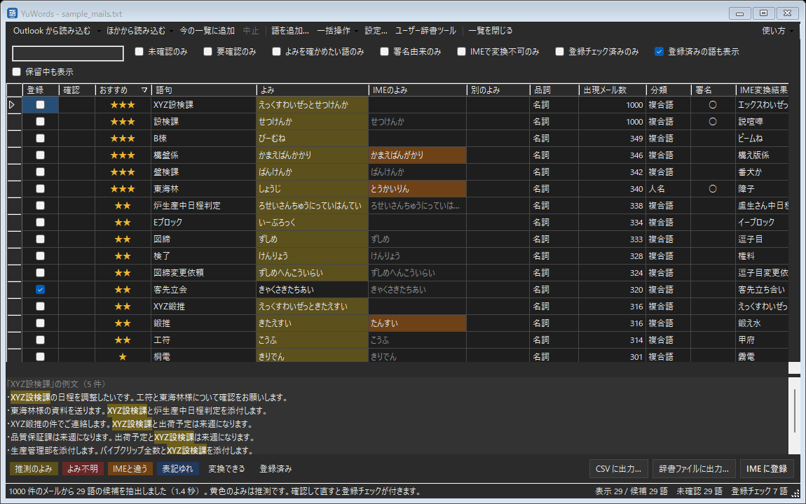

#  YuWords

自分が書いた文章（送信メール・Obsidian のノート・Excel など）から頻出語（社内用語・部署名・案件名など）を抽出し、Microsoft IME のユーザー辞書に登録するツール。

PC を乗り換えると IME の学習履歴はリセットされ、移行もできない。YuWords は自分の文章から語を集めてユーザー辞書に入れることで、乗り換えた直後から社内用語が変換候補に出るようにする。登録した語は持ち出し用のテキストにも保存するので、次の PC にもそのまま持っていける。

- データはすべてローカルで処理する（ネットワーク通信なし）
- キー入力の監視はしない

仕様は [docs/SPEC.md](docs/SPEC.md)、版ごとの変更は [CHANGELOG.md](CHANGELOG.md)。



<details>
<summary>暗い画面</summary>



</details>

画面写真は架空のデータです。

## 主な特徴

- **取り込み元**: Outlook（クラシック版）の送信済みメール（前回以降の差分だけも可）、フォルダ内の .md / .txt / .docx / .pptx（Obsidian の Vault など）、Excel・CSV の指定列。複数の取り込み元を1つの一覧にまとめることもできる
- **抽出**: 形態素解析（NMeCab ＋ UniDic）で名詞をつなげて複合語にし、前置き・敬称・一般語・記号入りの語を除く。長い複合語に共通する部分も候補にする。署名やあいさつの行は定型文（短縮よみ）の候補にする
- **よみ**: 辞書の仮名からの推測に加え、IME 自身にもよみを問い合わせ、食い違う語は「要確認」にして両方を並べる。人名は Outlook の連絡先・会社のアドレス帳のふりがなを使う。自分で決めた「よみのルール」と、前回直したよみも使う
- **確認画面**: おすすめ順（IME で変換できない語・よく使う語が上）、よみの修正と変換結果の確認、表記ゆれの印、短いよみの提案（品質保証課 → ひほか）、確認済み・保留、元に戻す。途中の状態は自動で保存し、次回続きから再開する
- **登録**: Microsoft IME のユーザー辞書に直接登録する。Google 日本語入力には、書き出したファイルを辞書ツールで取り込んで登録する。IME のユーザー辞書に既にある語は「登録済み」として扱う。直接登録できない IME では、ユーザー辞書ツールで取り込めるテキストに出力する
- **持ち出し・共有**: 登録した全語を `dictionary_backup.txt` に保存する（前の版も10個残す）。新しい PC ではこのファイルから一括で登録できる。Google 日本語入力・ATOK の形式でも書き出せ、同僚の辞書を候補として取り込める
- **自動チェック**: 毎週・毎月、新しいメールに未登録の候補があるかを調べて通知する（Windows のタスク スケジューラに登録）
- **環境チェック**: 辞書・Outlook・IME が使えるかをまとめて確かめ、結果をコピーできる。動作ログ（本文は含めない）も残す

## 動作環境

- Windows 10 / 11（Microsoft IME）
- メールを取り込む場合は Outlook クラシック版（新しい Outlook は COM に対応していないため使えない）
- 配布版は .NET ランタイムを同梱しているので、別途インストールは要らない

## インストール・更新

配布版の zip を展開し、フォルダごと好きな場所（ドキュメントやデスクトップなど、自分が書き込めるフォルダ）に置いて `YuWords.exe` を起動する。インストーラも管理者権限も要らない。

**自動更新**: 起動したときに新しい版を確かめ（1日に1回まで）、あれば変更点を見せて「今すぐ更新」で差し替えて起動し直す。「使い方」→「更新を確認...」でも確かめられる。設定や登録済みの語は `%APPDATA%\YuWords\` にあるので消えない。

**会社の環境**: Windows のプロキシ設定とログイン中のアカウントの認証情報で GitHub に接続する（送るのは版の問い合わせだけ）。GitHub につながらないときは次のどちらかで更新できる。

- ［設定］→［更新］で確認先を「社内の共有フォルダ」にし、そのフォルダに GitHub のリリースから `YuWords-x.y.z-win-x64.zip` を置く（同じ場所に `zip の名前.sha256` を置くと、壊れていないかも確かめる）
- 「使い方」→「ファイルから更新...」で、手元の `YuWords-x.y.z-win-x64.zip` を選ぶ

Program Files など書き込めない場所に置いていると更新できないので、そのときは自分のフォルダに移す。

## 使い方

画面の「使い方」（F1）に、色の意味とキー操作の一覧がある。

1. 「Outlook から読み込む」で送信済みメールから候補を集める（Outlook クラシック版を起動しておく）
   - ▼の「前回以降の新しいメールだけ」で、月に1回などの追加にも使える
   - 「ほかから読み込む」でフォルダ（Obsidian・テキスト・Word・PowerPoint）や Excel・CSV も読める。Excel・CSV は、1行に1語の用語集（語句とよみの列）をそのまま取り込むことも、文章の列から語を抽出することもできる
   - 「今の一覧に追加」を ON にしてから読み込むと、今の一覧に足して数え直す（選択は残る）
2. 一覧で登録する語を選ぶ（読み込み直後は「おすすめ」の高い順）
   - 黄色のよみは推測、赤は不明。橙の「IMEのよみ」は推測と食い違うもので、ダブルクリックで採用できる
   - よみを直すと要確認が外れ、登録チェックが付き、IME の変換結果も取り直す。直したよみは次回も使う
   - 見終えた行は Enter で確認済みにして次へ。「未確認のみ」で残りだけを表示できる
   - 右クリックで登録 ON/OFF・短いよみを付ける・このよみをルールにする・品詞の設定・保留・除外など。Ctrl+Z で元に戻せる
   - 一覧に無い語は「語を追加...」（Ctrl+N）で足せる
   - 表の下に、選んだ語の例文が最大5件出る。「一括操作」で表示中の行をまとめて確認済み・登録 ON/OFF・よみの置き換えなど
   - 設定を変えたら、読み込み直さずに今の一覧を数え直せる
3. 「IME に登録」でユーザー辞書に登録する（登録後、そのよみで変換できるようになったかも確かめる）
   - 直接登録できなかったときは、辞書ファイルに出力してユーザー辞書ツールを開く。ツールの［ツール］→［テキスト ファイルからの登録］で取り込む
   - Google 日本語入力が入っていれば「Google 日本語入力に登録」が出る。押すと Google 形式のファイルを書き出して辞書ツールを開くので、［管理］→［新規辞書にインポート］で取り込む（ファイルの場所はクリップボードに入る）
   - 「辞書ファイルに出力...」では Google 日本語入力・ATOK の形式も選べる

### 同僚と共有する

［設定］→［登録済みの語］→［共有用に書き出す...］で辞書ファイルを作って渡す。受け取った人は「ほかから読み込む」→「同僚の辞書」で、自分の一覧に候補として足せる（分類「共有辞書」）。

### 自動チェック

［設定］→［抽出］の「自動チェック」で頻度（毎週月曜・毎月1日）と時刻を選ぶと、Windows のタスク スケジューラに登録する（「しない」で解除）。その時刻に、前回 Outlook から読み込んだあとの新しいメールを調べ、未登録の候補があれば通知する。通知をクリックすると YuWords が開き、新しいメールだけを読み込む。

### うまく動かないとき

「使い方」→「環境チェック...」で、辞書・Outlook・IME が使えるかを確かめられる（IME のユーザー辞書は読むだけで、何も登録しない）。結果はコピーできる。動作ログは「使い方」→「ログのフォルダを開く」から見られる（件数・時間・エラーだけで、本文や語は含めない）。

登録した語は次回から薄く表示する（「登録済みの語も表示」を外すと隠れる）。登録の取り消しは［設定］→［登録済みの語］から行う。

### 新しい PC に移るとき

初めて起動したときに案内が出る。前の PC の `dictionary_backup.txt`（保存先は［設定］→［持ち出し用辞書］で OneDrive などに変えられる）を選ぶと、IME にまとめて登録する。あとからは［設定］→［持ち出し用辞書］→［ファイルを選んで IME に登録...］で選ぶ。CSV（語句・よみ・品詞）からも登録できる。

### 保存されるもの

`%APPDATA%\YuWords\` に置く。

| ファイル | 内容 |
|---|---|
| `settings.json` | 抽出の設定（対象期間・最大件数など）、ストップワード・前置き語の追加分、よみのルール |
| `excluded.json` | 除外リスト |
| `registered.json` | 登録済みの語（語句・よみ・品詞・日時） |
| `held.json` | 保留にした語（選んだよみ・品詞） |
| `learned.json` | 確認画面で直したよみ |
| `session.json` | 確認画面の途中の状態（例文を含む） |
| `dictionary_backup.txt` | これまで登録した全語（IME 取り込み形式）。保存先は設定で変えられる。前の版は `backups` に10個残す |

### コンソール版

`YuWords.Cli.exe` で、画面を使わずに抽出して CSV と IME 取り込み用テキストを出力できる。

```bash
YuWords.Cli.exe outlook --days 180 --out out
```

| コマンド | 内容 |
|---|---|
| `outlook` | Outlook の送信済みメールから抽出 |
| `folder <フォルダ>` | フォルダ以下の .md / .txt / .docx / .pptx から抽出 |
| `table <xlsx/csv> <列名> [--sheet 名前] [--no-header]` | 表の指定列から抽出 |
| `file <テキスト>` | `---` だけの行で区切ったテキストをメール群として抽出（試験用） |
| `diagnose` | 辞書・Outlook・IME が使えるかをまとめて確かめる（登録はしない） |
| `ime-probe` | IME の変換エンジンとユーザー辞書を開けるかだけ確かめる（登録はしない） |
| `update-check [版]` | GitHub に新しい版があるかを確かめる（取ってはこない） |
| `phonetic <語> ...` | IME に表記を渡したときのよみを表示 |
| `terms <テキスト>` / `tokens <文>` | 1行ずつの抽出結果 / 形態素解析の結果を表示 |

オプション: `--days`（対象期間・日）、`--max`（最大件数）、`--min`（何件以上に出た語を候補にするか）、`--out`（出力先）

## ビルド

辞書（UniDic、約 250MB）は Git に入れていないので、最初に一度取得する。

```bash
powershell -ExecutionPolicy Bypass -File tools/get-dictionary.ps1
```

```bash
dotnet build -c Release
```

```bash
dotnet test
```

配布用のポータブル版（`dist\YuWords` と zip）を作る:

```bash
powershell -ExecutionPolicy Bypass -File tools/publish.ps1
```

GitHub のリリースを作る（`CHANGELOG.md` にその版の項目を書き、コミットと push を済ませてから。既定は下書き、`-Publish` ですぐ公開）:

```bash
powershell -ExecutionPolicy Bypass -File tools/release.ps1
```

## 構成

| フォルダ | 内容 |
|---|---|
| `src/YuWords` | 確認画面（WinForms） |
| `src/YuWords.Core` | 抽出エンジン、取り込み元、IME 連携（変換・登録）、設定の保存 |
| `src/YuWords.Cli` | コンソール版 |
| `tests/YuWords.Tests` | 単体テスト |
| `tools/` | 辞書の取得・配布物の作成 |
| `dict/unidic` | UniDic 2.1.2（[unidic-lite](https://pypi.org/project/unidic-lite/) から取得。BSD ライセンス） |
| `licenses/` | 同梱している第三者のソフトウェアのライセンス文 |

## ライセンス

YuWords は [MIT ライセンス](LICENSE) です。

同梱している第三者のソフトウェア（NMeCab：LGPL-2.1、UniDic：BSD）については [THIRD_PARTY_NOTICES.md](THIRD_PARTY_NOTICES.md) を見てください。
